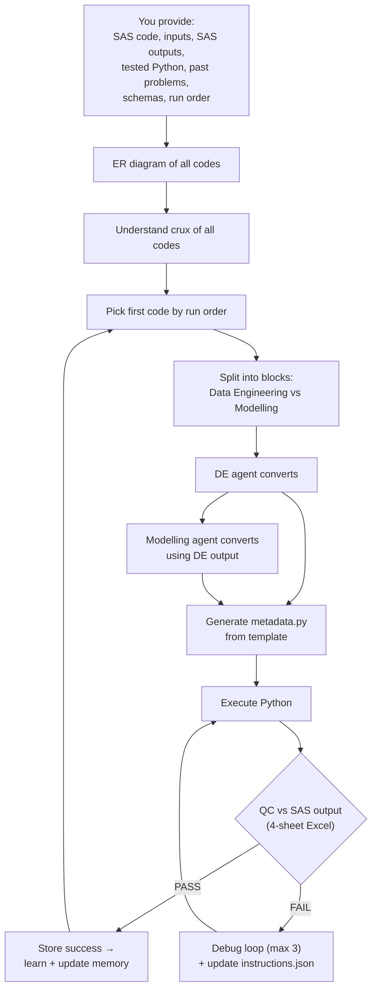
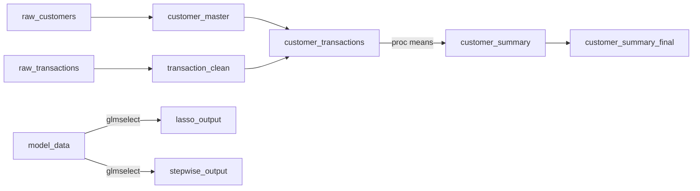

# Slither — SAS → Python Agentic Migration Framework

An AI-assisted framework that converts legacy SAS code to Python, where a
**deterministic QC engine is the backbone** and LLM agents work *inside* that
framework. The AI generates code; the QC engine decides PASS/FAIL. The system
never lets the AI grade its own homework.

---

## 1. What the finished system does



**Core principles**
- Deterministic QC is separate from the LLM — it produces the PASS/FAIL verdict.
- QC runs at *every* materialized dataset (a checkpoint), not only the final output.
- The QC engine returns a **result object**; Excel and the UI are just renderers of it.
- LLM is a swappable config value: open-source models now, Claude + a supervisor LLM later.
- "Learning" = a Conversion Memory + a growing `instructions.json` rulebook, **not** model fine-tuning.

---

## 2. Directory structure

```
SAS_to_Python_Agent/
├── SAS2PY/                        # THE ENGINE (on the import path via pyproject pythonpath)
│   ├── config/
│   │   └── settings.py            # QCConfig (tolerances, options), DatasetSpec
│   ├── src/
│   │   ├── qc/                    # ── Phase 1: deterministic QC engine ──
│   │   │   ├── loaders.py         #   read .sas7bdat/.csv/.xlsx/.parquet → normalized df
│   │   │   ├── result.py          #   QC result objects (source of truth)
│   │   │   ├── comparison.py      #   summary + cell-by-cell comparison (cell_comparison_frame)
│   │   │   └── engine.py          #   run_dataset_qc(...) → DatasetQCResult
│   │   ├── reporting/
│   │   │   └── excel_report.py    #   4-sheet QC Excel renderer (populated Cell_Comparison)
│   │   ├── metadata/
│   │   │   └── generator.py       #   render per-program metadata.py from a spec
│   │   ├── parser/                # ── Phase 2: SAS understanding ──
│   │   │   └── sas_parser.py      #   split into steps, extract dataset lineage
│   │   ├── graph/
│   │   │   └── dependency.py      #   dataset/program dependency graph + ER (DOT/JSON/PNG)
│   │   ├── knowledge/             # rule retriever (reads semantic_layer/knowledge)
│   │   ├── agents/  orchestration/  learning/
│   ├── templates/
│   │   └── metadata_template.py   # generic import/export/variables module
│   ├── ui/                        # Streamlit app (Home.py + pages/, assets, theme)
│   ├── samples/                   # INPUTS for the agent (not imported by the engine)
│   │   ├── sas/                   #   synthetic SAS programs the agent converts (01–08)
│   │   └── oracle/                #   self-contained SAS: dummy data + ground-truth CSVs
│   └── semantic_layer/            # the knowledge the agent follows
│       ├── knowledge/             #   live markdown rules (always used)
│       ├── knowledge_v2/          #   JSON rule cards (opt-in via KNOWLEDGE_V2_DIR)
│       └── reference/             #   tested clean-room reference implementations
│           ├── generic/           #     sas_utils.py, glmselect.py, matrix_rank.py, ...
│           └── algo/              #     glspln, RBNN.py
├── data/
│   ├── ground_truth/              # committed SAS baseline CSVs for QC
│   ├── users/                     # local accounts (gitignored, never committed)
│   └── learning/                  # learned proposals memory (gitignored)
├── Workspaces/                    # per-user conversion output folders (gitignored)
├── archive/                       # legacy runs + orphaned files (gitignored, safe to delete)
├── scripts/
│   ├── run_sample01/02/03.py      # convert a sample end-to-end
│   └── analyze_samples.py         # parse samples → lineage JSON/DOT/PNG
├── tests/                         # pytest: QC engine, metadata, parser/graph, agents
├── docs/                          # PROJECT.md, migration notes, TODO
├── requirements.txt
└── pyproject.toml                 # pythonpath = ["SAS2PY"]
```

---

## 3. Features built so far

### Phase 1 — Deterministic QC backbone ✅

| Component | File | What it does |
|---|---|---|
| Config | `config/settings.py` | `QCConfig` (abs/rel tolerance, case-insensitive columns, string strip, record caps) and `DatasetSpec` (optional per-dataset key columns). |
| Multi-format loader | `src/qc/loaders.py` | Reads `.sas7bdat` (pyreadstat), `.csv`, `.xlsx/.xls`, `.parquet` into a normalized DataFrame. Handles the fact that SAS outputs may arrive in any of these formats. |
| Result objects | `src/qc/result.py` | `DatasetQCResult`, `SummaryResult`, `CellResult`, etc. Structured PASS/FAIL — the single source of truth that every renderer consumes. |
| Comparison | `src/qc/comparison.py` | **Summary**: row/column counts, missing counts, mean/std/min/max within tolerance. **Cell-by-cell**: key-based row alignment when unique keys exist, otherwise a deterministic sort-positional fallback. Numeric compare uses tolerance; strings compared exactly (stripped); both-NaN treated as equal. Column matching is case-insensitive (SAS semantics). |
| Engine | `src/qc/engine.py` | `run_dataset_qc(name, sas, python, key_columns, ...)` accepts file paths **or** in-memory DataFrames and returns a `DatasetQCResult`. |
| Excel report | `src/reporting/excel_report.py` | The 4 sheets: **SAS_Output**, **Python_Output**, **Summary_Comparison**, **Cell_Comparison** — with PASS/FAIL coloring and an overall status banner. |
| metadata.py | `templates/metadata_template.py` + `src/metadata/generator.py` | A generic, self-contained module (`import_data`, `export_data`, `VARIABLES`) and a generator that fills it per program. Converted Python imports its I/O and variables from here. |

### Phase 2 — SAS understanding (parser + ER diagram) ✅

| Component | File | What it does |
|---|---|---|
| SAS parser | `src/parser/sas_parser.py` | Splits a program into `DATA`/`PROC` steps and extracts, per step, the datasets it **reads** (`SET`/`MERGE`/`UPDATE`/`MODIFY`, `DATA=`) and **creates** (`DATA` statement, `OUT=`/`OUTPUT OUT=`). Captures `libname` mappings and tags each step `data_engineering` vs `modelling` (by PROC name). |
| Dependency graph / ER | `src/graph/dependency.py` | Builds a directed dataset-lineage graph (NetworkX), classifies each dataset as source / intermediate / terminal, and exports JSON, Graphviz **DOT**, and an optional PNG. Also builds a program-to-program graph. |

**Example lineage** (from the three sample programs, 20 datasets / 19 edges):



---

## 4. Phase roadmap & status

| Phase | Focus | Status |
|---|---|---|
| 1 | metadata template + QC engine + 4-sheet Excel | ✅ Done |
| 2 | SAS parser + dependency graph + ER diagram | ✅ Done |
| 3 | Block splitter (DE/Modelling) + DE & Modelling agents + LLM provider abstraction | ⏳ Next |
| 4 | Orchestrator + QC checkpoint gating + debug loop (max 3) | ⬜ Planned |
| 5 | Learning loop + `instructions.json` | ⬜ Planned |
| 6 | Streamlit UI (ER diagram, progress, QC download) | ⬜ Planned |

**MVP scope** — Data Engineering: DATA step, WHERE/IF, KEEP/DROP, RENAME, SORT,
MERGE, PROC SORT, PROC MEANS, aggregations. Modelling: PROC REG, GLM, GLMSELECT
(LASSO, STEPWISE).

---

## 5. How to run

```bash
# one-time setup
python3 -m venv .venv
source .venv/bin/activate
pip install -r requirements.txt

# run the test suite
python -m pytest -q

# launch the web UI (dark theme by default)
streamlit run SAS2PY/ui/Home.py

# convert a sample program end-to-end (needs GROQ_API_KEY) → Workspaces/<user>/conversions/
python scripts/run_sample01.py

# analyze the sample SAS programs → lineage artifacts under Workspaces/_cli/analysis/
python scripts/analyze_samples.py

# regenerate the project TODO workbook
python scripts/generate_todo_excel.py
```

---

## 6. Design decisions locked in

- **QC returns a result object; Excel/UI render it** — keeps the verdict reusable across surfaces.
- **Keys are optional per dataset** — unique-key alignment when available, deterministic sort fallback otherwise.
- **Multi-format SAS outputs** — `.sas7bdat` / CSV / Excel all supported.
- **Case-insensitive column matching** — matches SAS semantics.
- **Provider abstraction (planned Phase 3)** — start on open-source LLMs, upgrade to Claude with no architecture change.
